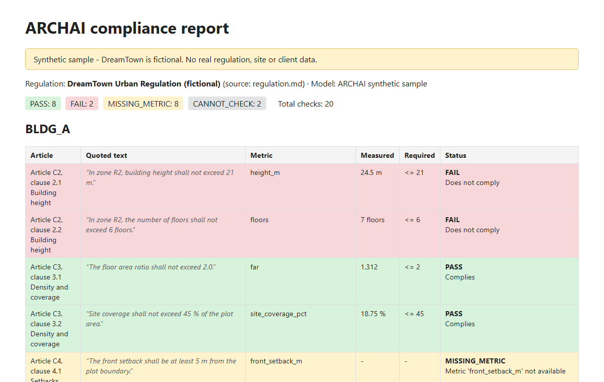
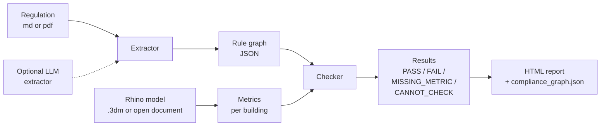

# archai-compliance

Checks building geometry from Rhino against a written urban regulation and reports, for each building and each rule, PASS, FAIL, MISSING_METRIC or CANNOT_CHECK, with the article and clause it cites.



*Report for the synthetic sample: BLDG_A fails height and floors, BLDG_B passes. Animated version: [docs/media/demo.gif](docs/media/demo.gif).*

## Quickstart

No API key and no Rhino needed for the first path. Python 3.11 or newer.

PowerShell:

```powershell
uv venv --python 3.11
uv pip install -e ".[dev]"
.\.venv\Scripts\python -m archai demo --offline --out out/demo
.\.venv\Scripts\python -m pytest -q
```

bash:

```bash
uv venv --python 3.11
uv pip install -e ".[dev]"
.venv/bin/python -m archai demo --offline --out out/demo
.venv/bin/python -m pytest -q
```

The demo takes under a second and writes `out/demo/report.html`, `rule_graph.json`, `results.json` and `compliance_graph.json`. Open the HTML file in a browser.

Run the stages one at a time (same synthetic inputs):

```bash
python -m archai extract corpus/dreamtown/regulation.md --out out/rule_graph.json
python -m archai metrics examples/sample-site.3dm --out out/metrics.json
python -m archai check --rules out/rule_graph.json --metrics out/metrics.json --out out/results.json
python -m archai report --results out/results.json --out out/report.html
```

### In Rhino 8 (Windows)

Two options. The automated tests do not cover either, because they need Rhino.

- Script: open `examples/sample-site.3dm`, run `rhino/archai_extract_metrics.py` from the Script Editor. It writes the same `metrics.json` as the `metrics` command above. Steps in [rhino/README.md](rhino/README.md).
- Plug-in: `cd plugin && dotnet build -c Release` produces `ArchaiCompliance.rhp`. The panel scans the layers, exports metrics and calls `python -m archai`. Steps and environment variables in [plugin/README.md](plugin/README.md).

### Optional: LLM and vector index

Bring your own key. Set `OPENAI_API_KEY` (and optionally `ARCHAI_OPENAI_MODEL`, `ARCHAI_EMBED_MODEL`); see `.env.example`. Install the extras with `uv pip install -e ".[llm,index]"`.

- `python -m archai extract <regulation.pdf> --llm openai` reads regulations that are not in the structured format the built-in extractor expects. The output is validated against a JSON schema and retried up to twice.
- `python -m archai index <regulation> --embeddings openai` builds a ChromaDB index at runtime. The index is git-ignored.

The model never decides a verdict. Verdicts come from the deterministic checker.

## What it does



- Reads a regulation with numbered articles and clauses ("shall not exceed 21 m") and turns each limit into a rule with its article id and quoted text.
- Reads a Rhino model by layer convention: `SITE::BOUNDARY`, `BLDG_<id>::FOOTPRINT`, `BLDG_<id>::FLOORS`, `BLDG_<id>::MASS`. Floors come from user text such as `floors=7`.
- Computes plot area, footprint, site coverage, floor area ratio, height and floor count, converted to metres.
- The same metric functions run in plain Python (via `rhino3dm`) and inside Rhino 8 (via RhinoCommon).
- Compares each metric with each rule using numeric comparison and unit normalisation.
- A rule with no measurable input is reported as MISSING_METRIC. A qualitative rule is reported as CANNOT_CHECK. Neither is turned into a pass.
- Writes one HTML row per check with the cited article, the measured value and the required value.
- The CLI and the Rhino plug-in share one engine. The plug-in only collects geometry and calls the CLI.

More detail: [docs/architecture.md](docs/architecture.md).

## What is synthetic

Everything in the repository is invented. No real regulation, site, client or model is included.

| File | What it is |
|---|---|
| `corpus/dreamtown/regulation.md` | "DreamTown Urban Regulation (fictional)", 8 articles, C1 to C8. DreamTown does not exist. |
| `corpus/dreamtown/regulation.pdf` | The same text rendered to PDF, so the PDF path is exercised. |
| `examples/sample-site.3dm` | A site of about 9,600 m² and two buildings, `BLDG_A` and `BLDG_B`, built with `rhino3dm`. |
| `examples/sample-site-missing.3dm` | The same site without the `BLDG_B::MASS` geometry, to show MISSING_METRIC. |
| `examples/metrics.sample.json` | Metrics read from the sample `.3dm`. |
| `examples/expected-report.html` | The report the offline demo produces. |

Regenerate the PDF, both `.3dm` files and the metrics JSON:

```bash
python examples/make_sample.py
```

## Status

Results from this edition's test and demo runs:

- `pytest -q`: 92 passed, 0 failed.
- `ruff check .`: all checks passed.
- `python -m archai demo --offline`: exit 0, 20 checks on the sample (8 PASS, 2 FAIL, 8 MISSING_METRIC, 2 CANNOT_CHECK).
- `dotnet build -c Release` in `plugin/`: succeeded for net48 and net7.0-windows, 0 warnings, 0 errors.

Not verified here:

- The Rhino 8 script and the plug-in have not been loaded in Rhino by the automated runs. The manual steps are in `rhino/README.md` and `plugin/README.md`.
- The CI workflow in `.github/workflows/ci.yml` (ubuntu and windows, Python 3.11 and 3.12) has not run yet.
- The LLM extractor is tested only against a mocked client, not a live model.
- The setback, parking and frontage rules show MISSING_METRIC because the sample model does not carry those measurements.

The original private version was an earlier prototype run against a real regulation. No figures from it are published. A separate earlier map-based prototype is not part of this repository.

## Origin

Built at an engineering consultancy; this edition is cleaned and runs on synthetic data.

Credit: the Rhino plug-in was co-authored with a classmate.

## Licence

MIT, see [LICENSE](LICENSE). Python dependencies keep their own licences. The C# plug-in restores `RhinoCommon` and `Newtonsoft.Json` from NuGet at build time.
